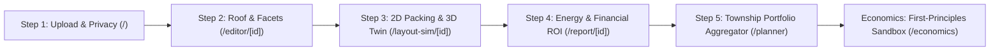

# SolarReady Malaysia ☀️🇲🇾 — Master Project Handover & Context Document

> **Document Purpose**: This comprehensive document details the entire architecture, physical algorithms, financial models, user journey, and cloud infrastructure of the **SolarReady Malaysia** platform. Any AI assistant can read this document to immediately understand the project state, codebase structure, and continue development seamlessly.

---

## 1. Project Background & Purpose

- **Project Name**: SolarReady Malaysia
- **Hackathon Context**: SDP University Hackathon 2026 (Organized by **Sime Darby Property**, Malaysia's leading master developer).
- **Track**: **Planet Track** (Energy Transition, Decarbonization & Net-Zero Townships).
- **Demonstration Townships**:
  - City of Elmina (Elmina West / Elmina Valley 3), Shah Alam, Selangor
  - Bandar Universiti Pagoh / Setia Indah
- **GitHub Repository**: `https://github.com/hming28/SolarReady.git` (Branch: `main`)

### 1.1 Core Mission
To eliminate AI hallucination, lack of physical scale, and unlocalized financial estimates in rooftop solar adoption. SolarReady equips **homeowners** with transparent, physics-grounded solar feasibility assessments and empowers **Sime Darby Property (SDP)** to aggregate thousands of residential rooftops into multi-megawatt **Virtual Power Plant (VPP)** assets.

---

## 2. Core Architectural Principles (Academic & Engineering Integrity)

1. **Zero Generative AI Hallucination**:
   - Solar panel placements are strictly calculated using **2D computational geometry (Python Shapely)** algorithms. Panels are never randomly "painted" by generative AI.
2. **Transparent Scale Calibration**:
   - Exact areas ($m^2$) and system capacities ($kWp$) are strictly concealed until the user or map calibrates scale ($m/\text{pixel}$) via an interactive virtual ruler.
3. **Malaysian-Localized Physics & Climate Modeling**:
   - Specific irradiance yields are sourced from European Commission **PVGIS v6 API** with Malaysian SEDA baselines ($1,385\text{ kWh/kWp/year}$).
   - Includes a realistic **14.0% tropical derate model** (high thermal derate $-0.35\%/^\circ\text{C}$, monsoon soiling/dust, inverter efficiency).
4. **Authentic TNB & Solar ATAP Tariff Logic**:
   - Models Peninsular Malaysia’s **TNB Domestic Tariff Schedule (Tarif A - Kediaman)** across all 5 consumption tiers (21.8 sen up to 57.1 sen/kWh).
   - Accurately distinguishes **Daytime Self-Consumption** (offsets high retail tariff) versus **Surplus Export Credit** (offsets energy charge ~27 sen/kWh under Solar ATAP / NEM 3.0).
5. **Dual-Perspective Value (B2C + B2B)**:
   - **B2C (Homeowners)**: Clears electric bills (~RM 380/mo to RM 0), safeguards against contractor fraud.
   - **B2B (Sime Darby Property)**: Accelerates GBI-certified home sales, achieves zero customer acquisition cost (CAC=0), and unlocks 25-year recurring energy lease revenue.

---

## 3. Technology Stack

- **Frontend**:
  - Next.js 14+ (App Router, Server & Client Components)
  - TypeScript, Tailwind CSS, Lucide React
  - **Canvas Editor**: `react-konva` (Interactive high-performance 2D drawing)
  - **3D Digital Twin**: `three.js`, `@react-three/fiber` (Real-time dynamic sun-path, rooftop shading, and architectural terrace models)
- **Backend**:
  - Python 3.12, FastAPI, Uvicorn
  - **Geometry Engine**: `shapely` 2.0.6, `numpy`
  - **Image Processing**: `Pillow` (EXIF stripping, LANCZOS orientation normalization, cropping, rotation)
  - **Data Contracts**: `pydantic` v2 (Strict separation of `_px` and `_m` units)
- **Cloud Infrastructure & Persistence**:
  - **Cloudflare R2 Object Storage** (S3-compatible API via `boto3`)
  - **Dual-write caching architecture**: Local disk for 0ms read latency + Cloudflare R2 bucket (`solarready`) for permanent disaster recovery.

---

## 4. End-to-End User Journey (The 5 Prototype Modules)



### Module 1: Landing & Privacy Scrubbing (`frontend/app/page.tsx`)
- Users upload an aerial or satellite screenshot of their rooftop.
- The backend immediately strips all EXIF GPS metadata to protect homeowner privacy.
- Select house typology (Terrace, Semi-D, Bungalow) and monthly TNB electricity bill (e.g., RM 380).

### Module 2: Interactive Roof Editor & Calibration (`frontend/app/editor/[id]/page.tsx`)
- **Virtual Ruler Calibration**: User draws a known line (e.g., 7.5m building front eaves) to calculate exact scale ($m/\text{pixel}$).
- **Rotation & Leveling**: Clockwise/counter-clockwise fine rotation to align roof ridge horizontally.
- **Rooftop Obstacle Buffer**: Mark vents, air-conditioner compressors, and water tanks with an automatic **0.30m safety clearance buffer**.
- **Edge Setback**: Enforces a strict **0.50m inward perimeter setback** for wind uplift and gutter clearance.
- **AI-Assisted Detection**: Optional Google Gemini Vision API to suggest roof polygon drafts.

### Module 3: Constrained Panel Simulation & 3D Twin (`frontend/app/layout-sim/[id]/page.tsx`)
- **2D Geometry Packing**: Evaluates mathematical polygon containment `UsableArea.covers(Panel)` with 0.02m clamp gaps. Supports Portrait and Landscape modes.
- **Dual Visual Modes**:
  1. *Realistic Mode*: Panels overlaid onto real satellite rooftop imagery.
  2. *CAD Blueprint Mode*: Clear schematic view with coordinate vectors, slopes, and dimensions.
- **Next-Gen 3D Digital Twin (`Roof3DViewer.tsx`)**:
  - Full-footprint Malaysian terrace house rendering.
  - Interactive **Time-of-Day Slider (08:00 - 18:00)**: Real-time tropical sun path, cast shadow calculations, and self-shading evaluation.

### Module 4: Energy Yield & TNB Financial ROI (`frontend/app/report/[id]/page.tsx`)
- **Physics Yield Engine**: Computes annual generation (kWh/yr) using PVGIS specific yields with tropical temperature derating.
- **Dynamic Self-Consumption Slider (20% - 100%)**:
  - Self-consumed solar energy offsets retail TNB domestic tariff (up to 57.1 sen/kWh).
  - Exported surplus credits back energy charges under Solar ATAP / NEM 3.0.
- **Financial Metrics**: Simple Payback Period (years), Monthly Bill Reductions (~100% net savings), and 25-Year Cumulative Cash Flow.

### Module 5: Township Portfolio Planner (`frontend/app/planner/page.tsx`)
- **Enterprise View for Sime Darby Property**:
- Aggregates hundreds of units across City of Elmina and Setia Indah into a Township Clean Energy Portfolio.
- Sorts units by **Delivered LCOE (Levelized Cost of Electricity in sen/kWh)** from lowest to highest.
- Filters by **Greenfield Launch** (pre-installed Solar-Ready homes, CAC=0) versus **Brownfield Retrofit** (existing homes).
- Quantifies total multi-megawatt potential (MWp) and annual community roof lease rentals.

### Module 6: First-Principles Sandbox (`frontend/app/economics/page.tsx`)
- Deconstructs solar Capex down to raw silicon wafers:
  - Module FOB Price ($/W), Inverter/BOS, Structure Mounting, and Customer Acquisition Cost (CAC).
  - **Idiot Index**: `Total Capex / Raw Module FOB Cost`.
- **4 Real-Time Sensitivity Sliders**:
  1. *Module FOB ($/W)*: Global supply chain fluctuations.
  2. *WACC (%)*: Cost of capital and green loans.
  3. *Wheeling Charge (sen/kWh)*: TNB grid TPA / CREAM wheeling fees.
  4. *Offtaker Tariff (sen/kWh)*: Commercial & Industrial (C&I) clean power purchase ceiling.
- **Core Conclusion**: Proves Greenfield Solar-Ready homes deliver energy at **~18.9 sen/kWh** (vs ~30.4 sen/kWh for retrofits), demonstrating SDP's 38% cost moat.

---

## 5. Recent Fixes & Milestones (Latest Git Commits)

1. **Commit `c66a71d` — Financial Calculation Cap & Robustness**:
   - Fixed `FinancialCard.tsx` bill reduction math; clamped maximum bill reduction percentage strictly at 100%.
   - Added surplus export credit accumulation and generation caps.
2. **Commit `787711b` — 3D Watertight Terrace & Photorealistic Visuals**:
   - Upgraded `Roof3DViewer.tsx` with dynamic continuous watertight roof shells, bargeboard gable alignment, and procedural monocrystalline wafer busbar textures.
3. **Commit `657cb62` — Removal of Silent Image Fallback**:
   - Removed backend silent fallback to generic `sample_elmina_terrace.jpg`.
   - Returns explicit 404 with friendly frontend prompt if an image is missing.
4. **Commit `9164e10` — Cloudflare R2 Permanent Cloud Persistence**:
   - Integrated AWS S3-compatible `boto3` client targeting Cloudflare R2 bucket `solarready`.
   - Automated dual-write for images (`images/{id}_working.jpg`) and assessments (`assessments/{id}.json`).
   - Automated cloud recovery: if server restarts or local container storage is wiped, assets automatically download from R2 upon access.
   - All 31 automated backend pytest tests and Next.js static builds pass with zero errors.

---

## 6. Directory Structure & Key Files

```
solar/
├── .env.example                       # Environment variables template
├── .env                               # Local secrets (R2, Roboflow, Gemini) - GITIGNORED
├── backend/
│   ├── requirements.txt               # fastapi, uvicorn, shapely, pillow, boto3, etc.
│   ├── app/
│   │   ├── main.py                    # Entry point & CORS
│   │   ├── config.py                  # Directory resolution & R2 config
│   │   ├── schemas.py                 # Unified Pydantic v2 data models
│   │   ├── routers/
│   │   │   ├── assessments.py         # Assessment CRUD, image endpoints, crop, rotate
│   │   │   ├── geometry.py            # Scale calibration & coordinate updates
│   │   │   ├── layouts.py             # Panel placement simulation
│   │   │   ├── energy.py              # PVGIS yield & carbon calculations
│   │   │   └── portfolio.py           # Township aggregation endpoints
│   │   └── services/
│   │       ├── cloud_storage.py       # Cloudflare R2 S3 storage client
│   │       ├── image_service.py       # Image validation & R2 upload
│   │       ├── storage.py             # Assessment JSON storage & R2 sync
│   │       ├── packing.py             # Shapely 2D geometry packing
│   │       └── economics_engine.py    # LCOE & sensitivity sandbox engine
│   └── tests/                         # 31 automated unit & integration tests
│
├── frontend/
│   ├── package.json                   # Next.js 14, react-konva, three.js, lucide-react
│   ├── app/
│   │   ├── page.tsx                   # Step 1: Upload & Privacy
│   │   ├── editor/[id]/page.tsx       # Step 2: Roof & Facet Editor
│   │   ├── layout-sim/[id]/page.tsx   # Step 3: Layout & 3D Viewer
│   │   ├── report/[id]/page.tsx       # Step 4: Solar Generation & TNB ROI
│   │   ├── planner/page.tsx           # Step 5: SDP Township Portfolio
│   │   └── economics/page.tsx         # First-Principles LCOE Sandbox
│   └── components/
│       ├── CanvasEditor.tsx           # Konva 2D interactive editor
│       ├── PanelOverlay.tsx           # Layout simulator canvas
│       ├── Roof3DViewer.tsx           # Three.js 3D dynamic shadow viewer
│       ├── FinancialCard.tsx          # TNB tariff & savings breakdown
│       └── ScaleModal.tsx             # Scale calibration dialog
│
└── data/
    ├── sample_roofs/                  # Built-in demo projects (Elmina, Setia Indah)
    └── storage/                       # Local cached assessment JSONs & images
```

---

## 7. How to Run Locally

### Start Backend
```powershell
cd backend
# Activate virtual environment
.venv\Scripts\activate
# Run server on port 8000
python -m uvicorn app.main:app --port 8000 --reload
```
- API Health Check: `http://localhost:8000/health`
- Swagger Documentation: `http://localhost:8000/docs`

### Start Frontend
```powershell
cd frontend
npm run dev
```
- Open browser: `http://localhost:3000`

### Run Test Suite
```powershell
cd backend
.venv\Scripts\python -m pytest tests -v
```

---

## 8. Cloudflare R2 Production Configuration
When deployed to cloud platforms (e.g. Render, Railway, Docker VPS), set these 4 environment variables:
```env
R2_ACCOUNT_ID=e70adddfebd40ac1bf9dcadd8d021673
R2_ACCESS_KEY_ID=3d9f5233b11dbed136605978cff47f24
R2_SECRET_ACCESS_KEY=2ce96ea49a021b2fcf1146e6356324b47e8b6cfb982ddff6764cb232e66c1130
R2_BUCKET_NAME=solarready
```
With these credentials active, all newly uploaded rooftop satellite photos and assessment JSON configurations are automatically preserved permanently in Cloudflare R2.
