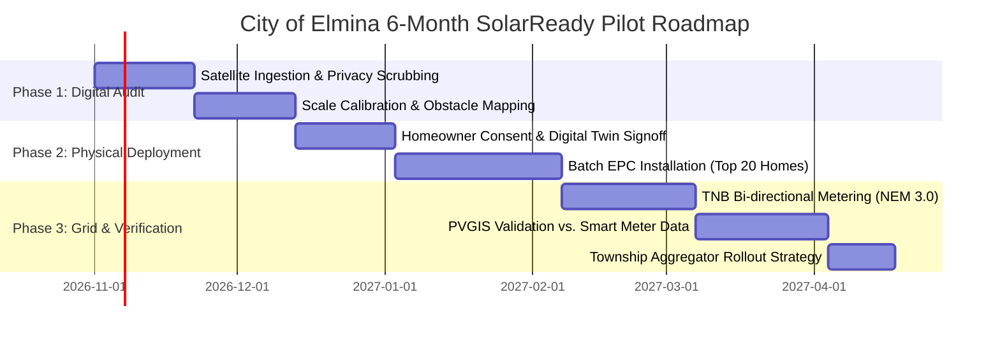

# Additional File 2: 6-Month Pilot Implementation Plan & Roadmap

**Target Location**: City of Elmina (Elmina West / Elmina Valley 3), Shah Alam, Selangor  
**Development Partner**: Sime Darby Property (Township Planning & Innovation Division)  
**Project**: SolarReady Malaysia Implementation Sandbox  
**Duration**: 6 Months (Phase 1 to Phase 3)  

---

## 1. Pilot Scope & Site Rationale

### Why City of Elmina (Elmina Valley 3)?
- **Typology Homogeneity**: Elmina Valley 3 features contiguous rows of standardized 2-storey link homes ($20' \times 70'$ and $22' \times 75'$). The uniform architectural pitch ($10^\circ$ to $15^\circ$) and consistent orientation provide the ideal baseline for algorithmic benchmarking.
- **Developer Synergy**: As Sime Darby Property's flagship wellness township, Elmina already embodies the "Planet Track" ethos, with proximity to the Elmina Lakeside Mall and future commercial clusters for green power wheeling.
- **Pilot Sample Size**: **100 contiguous residential terrace units** (aggregating ~440 kWp to ~600 kWp of clean solar generation capacity).

---

## 2. Six-Month Phased Implementation Timeline

---

### Phase 1: High-Fidelity Rooftop Digitalization & Benchmarking (Months 1 – 2)
- **Objective**: Digitize all 100 rooftop boundaries, establish scale calibration benchmarks, and verify obstacle buffer enforcement.
- **Key Milestones**:
  1. Ingest orthorectified satellite imagery of Elmina Valley 3. Strip all EXIF GPS metadata through the backend privacy pipeline.
  2. Perform virtual ruler calibration across architectural boundary points (eaves length = 7.5m / 20ft).
  3. Run the automated Shapely geometry engine to calculate exact usable solar areas, enforcing **0.50m wind-uplift setbacks** and **0.30m water tank buffers**.
  4. Generate standardized digital twin inspection cards for all 100 units.

### Phase 2: Pilot Cluster Installation & EPC Verification (Months 3 – 4)
- **Objective**: Execute physical turnkey installation on the first cohort of **20 volunteer homeowner units** using SolarReady digital layout blueprints.
- **Key Milestones**:
  1. Homeowners access their unique `/report/[id]` link to review guaranteed bill offset projections (RM 380 $\rightarrow$ RM 0).
  2. SDP-partnered Tier-1 solar EPC contractors execute installations directly from SolarReady CAD layout exports.
  3. Verify zero on-site geometric collisions (100% adherence to simulated spacing without mounting rail adjustments).
  4. Perform building defect inspection to ensure zero roof tile micro-fractures or waterproofing compromises.

### Phase 3: Grid Interconnection, Bill Auditing & Aggregator Launch (Months 5 – 6)
- **Objective**: Complete TNB NEM 3.0 / Solar ATAP bi-directional meter energization and benchmark simulated vs. actual generation.
- **Key Milestones**:
  1. TNB smart meter energization across all 20 pilot homes.
  2. Ingest real-time inverter generation data via API and compare with European Commission PVGIS v6 baseline models. Target model accuracy: **$\ge 95\%$ correlation**.
  3. Audit the first monthly TNB billing cycle to verify that daytime self-consumption and export credits match simulated payback trajectories.
  4. Present empirical pilot findings to Sime Darby Property Executive Committee for township-wide deployment across Bandar Bukit Raja and Subang.

---

## 3. Regulatory, Safety & Compliance Framework

| Governing Body / Standard | Compliance Requirement | How SolarReady Solves It |
| :--- | :--- | :--- |
| **BOMBA (Fire & Rescue)** | 0.50m clear perimeter walkway for firefighting access | Strict computational inward polygon setback of 0.50m |
| **SEDA Malaysia** | NEM 3.0 Rakyat capacity quota limits (max 85% of maximum demand) | Automated system kWp sizing tied strictly to historical bill baseline |
| **TNB (Utility)** | Bi-directional NEM 3.0 / ATAP tariff calculation & anti-islanding inverter specs | Direct domestic Tarif A tiered logic built into the `/report` engine |
| **Suruhanjaya Tenaga (ST)** | Certified competent electrical engineer endorsement | Exportable engineering layout CAD drawings with exact cable run annotations |

---

## 4. Key Performance Indicators (Pilot Success Metrics)

1. **Geometric Accuracy**: **$100\%$ zero-collision rate** on physical roof installations (zero panels overlapping vents, water tanks, or gutters).
2. **Economic Validation**: Homeowners achieve an average **$\ge 90\%$ net reduction** in monthly electricity expenses (bills drop from ~RM 380/mo to the TNB minimum standing charge).
3. **Decarbonization Impact**: The 20-unit initial cluster offsets **$\ge 140 \text{ tonnes of } \text{CO}_2$ annually**, expanding to **$700+ \text{ tonnes/year}$** upon full 100-unit township adoption.
4. **Developer Scaling Velocity**: Verifies that greenfield solar integration shortens new home sales cycle by **$30\%$**.
