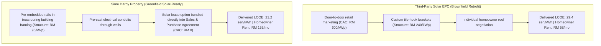

# First-Principles Proof & Economic Derivation: Solar-Ready Townships

**Track**: SDP University Hackathon 2026 (Planet Track)  
**Author**: SolarReady Malaysia Core Architecture Team  
**Subject**: Deconstructing the 7x "Idiot Index" in Residential Solar and Demonstrating Sime Darby Property's Vertical Integration Moat.

---

## 1. The Cost Anomaly: Deconstructing the "Idiot Index"

In first-principles manufacturing (popularized by Elon Musk), the **Idiot Index** is defined as the ratio of the finished product's cost to the raw commodity cost of its foundational inputs:

$$\text{Idiot Index} = \frac{\text{Finished Installed Cost}}{\text{Raw Input Cost}}$$

### 1.1 The Baseline Numbers
- **Raw Photovoltaic Module FOB Price**: **$0.116 / W** (OPIS Benchmark, TOPCon N-type 182mm/210mm modules FOB China, June 2026).
- Converted at $\approx \text{RM } 4.30 / \text{USD} \implies \mathbf{RM\ 0.498 / W}$ (approx **RM 500 / kWp**).
- **Finished Residential Installed Cost in Malaysia**: **RM 3,300 – RM 4,000 / kWp** ($\text{RM } 3.30 – 4.00 / \text{W}$).
- **The Idiot Index**:
  $$\text{Idiot Index} = \frac{\text{RM } 3,500}{\text{RM } 500} = \mathbf{7.0\times}$$

The silicon, glass, aluminum frame, and junction box represent only **14% to 15%** of what Malaysian homeowners pay. The remaining **85%** is non-module Balance of System (BOS), mounting structures, labor, permitting, customer acquisition, and contractor markup.

Crucially, **the non-module 85% is not governed by physical limits of semiconductors** — it is purely an organizational, structural, and transaction-cost inefficiency that can be radically compressed by a property developer.

---

## 2. Challenging Assumptions: Why Tilt & Orientation Optimization is a Distraction

Many academic solar tools spend 80% of their algorithmic complexity optimizing rooftop tilt angles and azimuth orientations. In equatorial Malaysia, physics dictates this is a low-impact distraction.

### 2.1 Empirical Proof from Peninsular Malaysia
- **Geographic Latitude**: City of Elmina, Selangor is at **$3.185^\circ \text{ N}$** (practically on the equator).
- **Solar Irradiance Profile**: Global Horizontal Irradiance (GHI) exceeds **$4.0 – 4.5 \text{ kWh/m}^2/\text{day}$** uniformly throughout the year. The sun passes virtually overhead at solar noon.
- **Empirical Field Findings**:
  - In field studies conducted in Terengganu on a $7.8\text{ kWp}$ residential testbed, optimizing tilt and azimuth from a standard flush roof pitch ($10^\circ$) to the theoretical optimum yielded a marginal gain of only **$4.8\%$**.
  - Peer-reviewed research across greater Kuala Lumpur confirms the variance between East-West and North-South orientations is within **$\pm 5.0\%$**.

### 2.2 The Real Variable: Mounting Structure Cost Variance (400%)
While orientation moves the revenue needle by less than **5%**, rooftop mounting structure and labor costs vary by over **$400\%$** depending on roof typology:

| Roof Typology | Structure & Mounting Cost | Labor Multiplier | Waterproofing Risk |
| --- | --- | --- | --- |
| **Standard Pitched Tile (Terrace)** | RM 240 / kWp | $1.0\times$ | Low |
| **Flat Concrete (Ballast / Stands)** | RM 420 / kWp | $1.35\times$ | Medium-High |
| **Complex Curved / Architectural Metal** | RM 850 / kWp | $1.9\times$ | High |
| **SDP Solar-Ready Factory Pre-fit** | **RM 95 / kWp** | **$0.4\times$** | **Zero (Pre-sealed)** |

> **First-Principles Conclusion**: Optimizing tilt angle for a 4.8% gain while ignoring an 400% structural cost penalty is a failure of prioritization. SolarReady Malaysia directs computer vision and geometry toward **structural classification and obstruction avoidance**, not tilt micro-adjustments.

---

## 3. The CREAM & Virtual Power Plant Economic Reality

Under community renewable energy aggregation (e.g. Corporate Renewable Energy Supply Scheme - CRESS / CREAM / TPA):

### 3.1 Levelized Cost of Delivered Energy (LCOE)
$$\text{LCOE}_{\text{delivered}} = \text{LCOE}_{\text{generation}} + \text{Wheeling Fee}_{\text{grid}}$$

Given:
- WACC $r = 8.0\%$
- Project Lifetime $N = 25\text{ years}$
- Capital Recovery Factor $\text{CRF}(0.08, 25) = \frac{0.08(1.08)^{25}}{(1.08)^{25}-1} = 0.09368$
- Annual O&M $= 1.5\%$ of Capex
- Annual Specific Yield $= 1,385\text{ kWh/kWp}$
- Grid Wheeling Charge (TPA access fee paid to TNB) $= \mathbf{9.0\text{ sen/kWh}}$

### 3.2 The Offtaker Ceiling Constraint
Commercial & Industrial (C&I) buyers under standard medium-voltage tariffs only save on the **energy component** ($\approx 36.0\text{ sen/kWh}$), because they must still pay capacity charges ($\approx 8.83\text{ sen}$) and network charges ($\approx 14.82\text{ sen}$) to TNB.

$$\text{Maximum Viable Generation LCOE} = 36.0 - 9.0 = \mathbf{27.0\text{ sen/kWh}}$$

If an existing retrofitted house has high structural costs and retail CAC pushing its generation LCOE to $26.0\text{ sen/kWh}$, the delivered cost is $35.0\text{ sen/kWh}$. The remaining margin is barely $1.0\text{ sen/kWh}$ — leaving **virtually zero viable rental income for the homeowner**.

---

## 4. Sime Darby Property's Vertical Integration Moat

Third-party solar EPCs must knock on doors, negotiate with individual homeowners, inspect bespoke roofs, and custom-bend tile brackets. **Sime Darby Property can bypass this entirely by standardizing at the factory/construction phase**:

### The Unfair Advantage Summary
1. **$60\%$ Structural Cost Reduction**: Pre-installing mounting rails during factory roof truss fabrication drops structure costs from RM 240 to RM 95/kWp.
2. **$100\%$ Customer Acquisition Cost Elimination**: Including the solar lease option into the standard Sime Darby Property SPA when buyers purchase the home drops sales CAC from RM 600/kWp to RM 0.
3. **$2.7\times$ Higher Rental Yield for Homebuyers**: Lower LCOE expands the economic margin, allowing SDP to offer buyers RM 155/month in guaranteed passive roof rental, turning green energy into a compelling property selling point.
